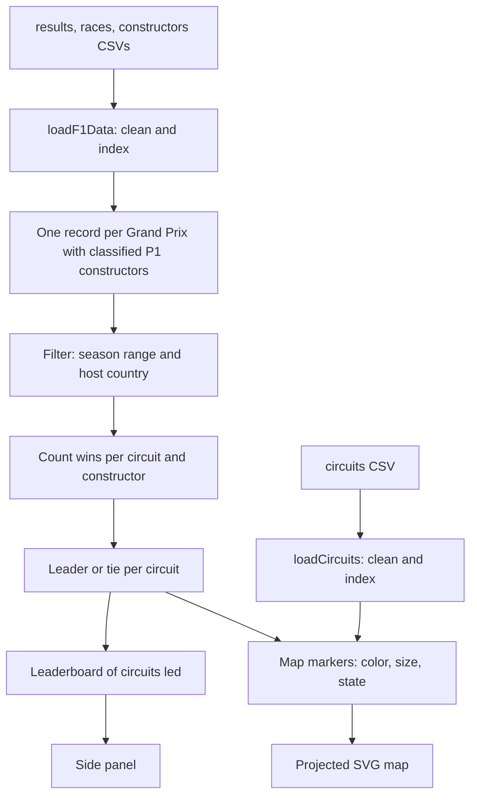

# Circuit visualization

[Back to README](README.md)

A world map answers one question: **which constructor has won the most Grands Prix at
each circuit?** One map marker is one circuit. Its color names the constructor with the
most wins there in the selected seasons; a side panel ranks constructors overall or
for one selected circuit.

The page is [`CircuitExplorer.jsx`](src/CircuitExplorer.jsx), opened with the
**Circuits** capsule. It has no internal tabs: the map is the single view.

## Data pipeline

| File | Key and purpose |
|---|---|
| `results.csv` | `resultId`; links race and constructor; supplies the official classified `position` |
| `races.csv` | `raceId`; season, round, name and `circuitId` |
| `constructors.csv` | `constructorId`; name and `constructorRef` (color key) |
| `circuits.csv` | `circuitId`; name, location, country, latitude and longitude |
| `drivers.csv`, `status.csv` | Loaded only because the shared [`loadF1Data.js`](src/lib/loadF1Data.js) cache also serves the Drivers page; not used by this map |

Not used: `sprint_results.csv`, standings, qualifying, lap times and pit stops.

1. **Load and clean:** [`loadF1Data.js`](src/lib/loadF1Data.js) loads and caches results,
   races, drivers, constructors and status, turning `\N`, blanks and invalid numbers into
   `null`. [`loadCircuits.js`](src/lib/loadCircuits.js) loads `circuits.csv` separately with
   the same cleaning rules; missing coordinates stay `null`.
2. **One record per Grand Prix:** `buildRaceWinners` in
   [`circuitWins.js`](src/lib/circuitWins.js) groups joined result rows by `raceId`.
   A race counts as a Grand Prix only if it has at least one result (scheduled races
   without results are excluded). Its winners are the distinct `constructorId`s of results
   with `position === 1`. `positionOrder` is never used, so a race without a classified P1
   keeps an empty winner list. A 1950s shared drive credited to two constructors gives
   each one win; two P1 rows for the same constructor count once. Races are sorted by
   season, round, then `raceId`.
3. **Filter:** `filterRaces` keeps an inclusive From/To season range and an optional host
   country (`circuits.country`). Empty bounds are open. A reversed range returns nothing
   and shows a validation message.
4. **Aggregate per circuit:** `summarizeCircuits` groups the filtered races by `circuitId`
   and counts wins per constructor:

   ```text
   wins(circuit, constructor) = number of filtered Grands Prix at circuit won by constructor
   ```

   Standings are ordered by wins (descending), then by the race at which the constructor
   first reached its total (earlier first), then by `constructorId`. The **leader** is the
   single constructor with the top total; if the top total is shared, there is no leader
   and the tied constructors are recorded instead.
5. **Leaderboard:** `circuitLeaderboard` counts, for each constructor, the circuits it
   leads outright (`led`), the circuits where it is tied for the lead (`shared`) and its
   total wins over the filtered circuits. It sorts by `led`, then `shared`, then wins.
6. **Markers:** `buildCircuitMarkers` in [`circuitMarkers.js`](src/lib/circuitMarkers.js)
   creates one marker per circuit that has ever hosted a Grand Prix (all seasons), even
   when the filters exclude it, so the map's geography stays stable. Its size domain comes
   from the unfiltered summaries of the whole archive (see Scales). In pie mode,
   `winShares` adds the slices of each active circuit.
7. **Render:** [`CircuitMap.jsx`](src/components/CircuitMap.jsx) projects coordinates with
   `d3.geoNaturalEarth1` (world land from `world-atlas` 110m, Antarctica removed) and
   renders SVG markers with React. D3 handles only the projection and the zoom behavior.
   [`CircuitPanel.jsx`](src/components/CircuitPanel.jsx) renders the rankings.



## Layout

The map uses a Natural Earth projection fitted to the panel width. A marker sits at its
circuit's latitude and longitude. Distances between markers are geographic only and
carry no data. Nearby circuits (especially in Europe) can overlap; zooming separates them.
Markers keep a constant on-screen size while zooming. They are drawn with selection on
top, then larger marks under smaller ones so every circuit stays clickable.

The side panel sits to the right of the map on wide screens and below it under 1000px.

## Visual encodings

### Default mode (no highlighted constructor)

| Channel | Meaning |
|---|---|
| Position | Circuit coordinates |
| Fill color | Team color of the outright leader at that circuit in the filtered seasons |
| Gray fill (45% opacity) | Circuit with races in range but a tied top total or no classified winner |
| Radius | Number of Grands Prix held there in the filtered seasons |
| Faint small dot (radius 2, 20% opacity, not focusable) | Circuit with no Grand Prix in the filters |
| Accent ring | Hover, keyboard focus or selection. Interaction feedback, not data |

### Highlight mode (one constructor selected)

| Channel | Meaning |
|---|---|
| Fill color | The highlighted constructor's team color, on circuits where it won at least once |
| Radius | That constructor's wins at the circuit |
| Hollow ring (radius 3) | Circuit with races in range where it never won |
| Faint small dot | Circuit with no Grand Prix in the filters |

### Pie mode (several seasons selected)

The **Dots / Pie charts** toggle above the map switches the active markers to pies. It is
disabled when the filtered races cover a single season, because then each circuit has a
single race and a pie would always be a full disc. The page falls back to dots in that
case, during playback for example, and returns to pies when the range widens again.

| Channel | Meaning |
|---|---|
| Slice angle | Share of the circuit's wins in the filtered seasons |
| Colored slices | The top 3 constructors at that circuit (standings order: wins, then who reached the total first), each in its team color, clockwise from 12 o'clock |
| Gray slice (theme text color, 35% opacity) | "Others": all remaining winning constructors combined |
| Highlight mode | Only the highlighted constructor's slice is colored; everyone else is "Others" |
| Radius | Grands Prix held in range, in both default and highlight mode |
| Plain gray dot | Circuit with races but no classified winner (no slice to draw) |
| Thin slice borders | Theme background color, so two adjacent teams with the same color stay separate. Not data |

Shares use win counts: a shared win counts once for each credited constructor, so the
denominator is the sum of credited wins, not the number of races. A tied leader shows
as equal slices. The top-3 limit (`PIE_TOP_CONSTRUCTORS`) keeps small pies readable.
The full ranking is in the circuit panel.

### Scales

```text
radius = 3 + 9 × sqrt(clamp(value / M, 0, 1))
default and pie modes: value = Grands Prix in range,
                       M = most Grands Prix at one circuit in the whole archive (Monza, 76)
highlight dots:        value = highlighted constructor's wins in range,
                       M = its most wins at one circuit in the whole archive
M falls back to 1 when it would be 0
```

The scale is square-root, so area grows roughly with the value. Units are screen pixels.
**The domain is fixed by the whole archive and does not change with the filters.** A dot
therefore means the same thing in every season range. A single season gives each circuit
about 4px, so neighbouring circuits in one country stay distinct, and the largest marker
appears only at a circuit with many races in range. Filtering never enlarges the dots.
The 3px minimum means areas are not exactly proportional.

### Colors

Constructor colors come from [`teamColors.js`](src/lib/teamColors.js), the same source as
the Drivers page (for example Ferrari `#e80020`, McLaren `#ff8000`, Mercedes `#27f4d2`).
Unknown historical teams hash into D3's `schemeTableau10`, so **two teams can share a
color**: names in the tooltip, panel and legend remain the reference. Colors are
categorical identity, not performance.

Precedence: a tie or a missing winner overrides any team color (gray). In highlight
mode, the highlighted team's color replaces the leader's. Land, borders, gray markers and
the accent ring use the theme tokens from [`index.css`](src/index.css) and adapt to light
and dark themes. The legend's default swatch samples three team colors to mean "a team
color", not one specific team.

### Season-by-season history (circuit panel)

`seasonTimeline` and `decadeRows` in [`circuitWins.js`](src/lib/circuitWins.js) build one
cell per season of the **filter's** range: From season (or the archive's first season)
to To season (or its latest), inclusive. The range does not stop at the circuit's own
first or last race. Cells are placed chronologically in a grid with one row per decade
(labeled `1950s`, `1960s`, …) and one column per final digit (0–9). Slots outside the
range are left blank.

| Cell | Meaning |
|---|---|
| Team color | The circuit hosted a Grand Prix that season, won by that constructor |
| Stacked bands | Several Grands Prix at the circuit that season (for example 2020), one band per race in date order |
| Left/right split inside a band | Shared win credited to two constructors |
| Gray (theme border color) | Circuit not used that season |
| Hatched gray | Grand Prix held but no classified winner |
| Accent outline | Hovered or focused season (interaction, not data) |

The country filter does not change the cells, since the circuit's country is fixed.
A summary line above the grid gives "Used in N of M seasons (from–to)".

## Labels and details

- **Summary row:** selected season range (and country), Grands Prix, circuits with races
  in range, and the number of constructors leading at least one circuit outright. In
  highlight mode it states how many circuits the team won at.
- **Map legend:** explains the color, gray or hollow, slice and size meanings for the active mode.
- **Tooltip (hover or keyboard focus):** circuit name, location and country, Grands Prix and
  seasons in range, the leader with its win total (or the tied constructors, or "No
  classified winner recorded"), in highlight mode that constructor's wins, and in pie
  mode the win share of each slice as a percentage. Inactive
  circuits show their all-time season span. Each marker's `aria-label` has the same text.
- **Panel, no circuit selected:** "Who rules the most circuits?" leaderboard showing the top
  10 constructors with a "Show all" toggle. The number and bar show outright leads; a
  smaller "+N" adds tied leads.
- **Panel, circuit selected:** name, location, Grands Prix, seasons and number of winning
  constructors. Wins by constructor are bars showing the top 8 with a "Show all" toggle.
  A note appears when the lead is tied. In the season-by-season grid, hovering or focusing
  a cell shows a line under the grid, for example "1980 · Austrian Grand Prix: Renault"
  or "1995 · circuit not used this season". Each cell also has the same text as its
  `aria-label` and title. A legend lists team color, not used, several Grands Prix and
  (when present) no classified winner. The grid is one tab stop: arrow keys move by a
  season (left/right) or a decade (up/down), and Home/End jump to the range bounds.

## Interactions

- **From / To season** (native selects): inclusive range. Changes the data, the scales
  and the leaders.
- **Play seasons:** steps through seasons one at a time (From = To = season, 1.2s each),
  starting from the chosen From season. Any manual filter change pauses it.
- **Host country:** limits the races to circuits in that country. Other circuits become
  faint.
- **Highlight a constructor:** a select listing every constructor with at least one win
  in the archive. Clicking a bar in either panel list toggles the same highlight.
- **Select a circuit:** click a marker, or Tab to it and press Enter or Space. Clicking it
  again, clicking the empty map or "← All circuits" returns to the leaderboard.
- **Dots / Pie charts:** changes only the marker style, not the data. It is disabled for a
  single season, with a note if pies were chosen.
- **Zoom/pan:** drag, scroll wheel, or +, − and Reset buttons. This changes the presentation
  only. Zoom transitions are skipped with `prefers-reduced-motion`. Resizing the window
  resets the zoom.
- **Reset** clears seasons, country and highlight. It keeps the selected circuit.

Loading, CSV error with retry, invalid season range and "no Grand Prix matches these
filters" states are handled.

## Interpretation limits

- Only Grand Prix results count. Sprint races, championship points and standings are not used.
- Constructors are counted by archive ID: renamed or successor teams (Toleman, Benetton,
  Renault, Alpine; Minardi, Toro Rosso, AlphaTauri, RB; and so on) stay separate, and
  engine-named entries such as "McLaren-Ford" or "Lotus-Climax" are separate from
  "McLaren" or "Team Lotus".
- A circuit ID covers every layout used at that venue. Changes to a track over time
  are not distinguished.
- Circuits with many races naturally accumulate more wins. Leads at circuits that held
  one or two Grands Prix are fragile.
- Coverage depends on the local archive (currently 1950 to its latest season with results).

## Implementation and validation

- Data: [`loadCircuits.js`](src/lib/loadCircuits.js), [`circuitWins.js`](src/lib/circuitWins.js),
  [`circuitMarkers.js`](src/lib/circuitMarkers.js)
- UI: [`CircuitExplorer.jsx`](src/CircuitExplorer.jsx), [`CircuitMap.jsx`](src/components/CircuitMap.jsx),
  [`CircuitPanel.jsx`](src/components/CircuitPanel.jsx), [`CircuitExplorer.css`](src/CircuitExplorer.css)
- Tests: [`tests/circuitWins.test.js`](tests/circuitWins.test.js) cover circuit indexing and
  missing coordinates, classified-P1 wins (`positionOrder` ignored), shared drives and
  duplicate rows, races without results, inclusive and reversed filters, tie ordering,
  leaderboard counts, the radius scale and its fixed archive domain, marker kinds and
  colors in both modes, pie win shares (top constructors, Others, highlight, empty), the
  season timeline over the filter range (unused seasons, two races in one season, reversed
  range) and its decade slots, and a
  real-archive check: every race joins a circuit, win totals reconcile, and Ferrari
  leads Monza. Run the [README validation commands](README.md#validation).
