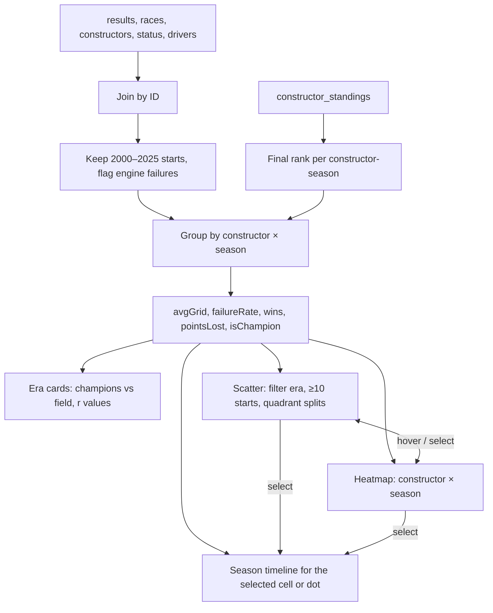

# Constructor speed × reliability visualization

[Back to README](README.md)

The **Constructors** page crosses three facts about every constructor-season from 2000
to 2025 to answer one central question:

> **Fast or reliable: what makes a champion?**

Its three linked views answer six sub-questions:

| # | Question | Where it is answered |
|---|---|---|
| 1 | How many engines did each team break, season by season? | Heatmap |
| 2 | Is the final rank explained by speed or by reliability? | Era cards (*r* values) and scatter plot |
| 3 | Do champions break fewer engines than the others? | Era cards and gold dots in the scatter plot |
| 4 | Which teams were fast but fragile and probably lost a title? | Scatter plot (top-left quadrant) and the "What the data says" list |
| 5 | How did this change across the V10, V8 and turbo-hybrid eras? | Era filter, era cards and heatmap era bands |
| 6 | How many points did engine failures cost a team in a given season? | Season detail |

**Unit of observation:** one dot or heatmap cell is one **constructor in one season**,
for example "McLaren 2000". It aggregates both of that team's cars over the season.

## Definitions

| Term | Definition used on the page |
|---|---|
| **Start** | A result row whose outcome is not DNQ (did not qualify) or DNS (did not start), as classified by [`raceResults.js`](src/lib/raceResults.js). |
| **Speed** | The average `results.grid` over starts with a grid slot greater than 0. **Lower is faster**: P2.6 means a front-row car. |
| **Engine failure** | A start with outcome `retired` and a status in `ENGINE_STATUSES`. Gearbox, hydraulics, electrical and accidents are excluded. |
| **Failure rate** | Engine failures ÷ starts. |
| **Final rank** | The constructors' championship position after the last round of the season (`constructor_standings.csv`). P1 means champion. |
| **Era** | A period with one set of engine rules: **V10** 2000–2005 (3.0 L, free development), **V8** 2006–2013 (2.4 L, frozen, long-life engines), **Turbo-hybrid** 2014–2025 (1.6 L V6 turbo + energy recovery). 2026 starts a new formula and is excluded. |
| **r** | The Pearson correlation, from −1 to +1. Grid position and rank both use "lower is better", so a **positive** *r* between them means faster teams finish higher. |

The engine-failure statuses are:
- **Engine and power unit:** Engine, Engine fire, Engine misfire, Power Unit, Turbo, ERS, Battery, Power loss.
- **Cooling:** Overheating, Cooling system, Radiator, Water pressure, Water leak, Water pump, Water pipe.
- **Oil:** Oil pressure, Oil leak, Oil pump, Oil line, Oil pipe.
- **Internals and fuel delivery:** Crankshaft, Spark plugs, Ignition, Injection, Fuel pressure, Fuel pump, Fuel system.

## Design rationale

| Framework | Application |
|---|---|
| **DIKW** | **Data:** result rows such as "car 22, started 3rd, status *Engine*". **Information:** "McLaren 2000: average grid P2.6, 12% failures, 2nd in the championship". **Knowledge:** speed puts a team in the title fight, and among the fast teams the more reliable one wins (V10, hybrid); in the V8 era everyone was reliable. **Wisdom:** a team must be fast first, but it must not trade reliability for performance. Three titles were lost by fewer points than engine failures cost. |
| **What / Why / How** (Munzner) | **What:** a multivariate table of constructor × season, with three quantitative attributes (grid, failure rate, wins) and one ordinal attribute (final rank), plus a temporal axis. **Why:** *discover* a **correlation** between three variables, *compare* eras, *locate* **outliers** such as Ferrari 2008, which was fast, fragile and still champion. **How:** two positional channels for the two continuous variables, color for the rank group, area for wins, a sequential intensity for the failure counts, and linked highlighting. |
| **Shneiderman's mantra** | **1. Overview:** era cards and the speed × reliability scatter plot. **2. Zoom & filter:** the era filter and the constructor × season heatmap. **3. Details on demand:** tooltips and the season-detail line chart with its failure table. |
| **Brushing & linking** | Hovering a constructor in the scatter plot or the heatmap dims every other team in both views. Selecting a dot or cell opens the same season in the detail view, and the selection is outlined in both overview views. |
| **Overview + Detail** | Separate, undistorted views: the scatter plot and heatmap form the overview, and the season timeline is the detail. |
| **Situation awareness** (Endsley) | **Perception:** where the gold dots sit. **Comprehension:** the quadrants and the champion-vs-field rates. **Projection:** the "without engine failures" line shows what would plausibly have happened. |

A scatter plot is the standard form for relating two quantitative variables. The third
variable, the outcome, is added through color and size rather than a second axis. The
heatmap is the most compact way to show a count over two categorical/temporal
dimensions (team × season). A cumulative line chart is the natural form for a
championship that builds up race by race.

## Source data

| File | Key and columns used |
|---|---|
| `results.csv` | `resultId`; `raceId`, `driverId`, `constructorId`, `statusId`, `grid`, `position`, `positionText`, `points`, `laps` |
| `races.csv` | `raceId`; `year`, `round`, `name` |
| `constructors.csv` | `constructorId`; `name`, `constructorRef` (team color) |
| `status.csv` | `statusId`; `status` (engine-failure classification) |
| `drivers.csv` | `driverId`; driver names in the failure table |
| `constructor_standings.csv` | `raceId`, `constructorId`, `position` (final rank only) |

The first five files come from the shared [`loadF1Data.js`](src/lib/loadF1Data.js).
Standings are fetched by [`loadConstructorStandings.js`](src/lib/loadConstructorStandings.js),
which reuses the same `dataUrl` helper.

Deliberately not used:
- `lap_times.csv` (24 MB): it would allow estimating the running position at the moment of failure, but it is too heavy to load in the browser.
- `qualifying.csv`: `results.grid` already reflects grid penalties, and qualifying sessions changed format.
- `sprint_results.csv`, `pit_stops.csv`, `driver_standings.csv`, `constructor_results.csv`.

## Transformation pipeline

All of the logic lives in [`engineReliability.js`](src/lib/engineReliability.js).

1. **Final standings (`indexFinalStandings`):** for each year, take the standings race with the highest round, then map `constructorId:year` to its position.
2. **Season rows (`buildSeasonRows`):**
   - Keep results whose race year is inside an era.
   - Drop DNQ and DNS results.
   - Group by `constructorId:year`, then count starts, engine failures, wins (`position === 1`) and race points (missing points count as 0).
   - Average the grid slots greater than 0 (`avgGrid`, or `null` if there are none).
   - Count finished starts and the points scored in them.
3. **Derived fields:**

   ```text
   failureRate     = failures ÷ starts
   pointsPerFinish = points in finished starts ÷ finished starts   (0 if none)
   pointsLost      = failures × pointsPerFinish
   isChampion      = finalPosition === 1
   ```

4. **Era summaries (`summarizeEras`):**
   - `fieldFailureRate` is calculated over every start in the era.
   - `championFailureRate` is calculated over the champions' starts.
   - The two *r* values are calculated over seasons that have both a final rank and an `avgGrid`.
5. **Scatter filtering:**
   - Seasons with `avgGrid = null` or fewer than **10 starts** are left out of the scatter plot only, because one-off entries would sit at extreme rates by chance.
   - The era filter then keeps one era, or all of them.
6. **Quadrants (`quadrantSplits`):** the vertical line is the **median `avgGrid`** of the visible seasons. The horizontal line is their **starts-weighted failure rate**. Both are recomputed when the era filter changes.
7. **Season timeline (`buildSeasonTimeline`):**
   - For one constructor-season, sum the team's points per round.
   - Do the same for the rival: the champion, or the runner-up when the team itself is champion.
   - The "without engine failures" line adds `pointsPerFinish` at each round with a failure.
   - `gap` = rival total − team total. The `failuresExplainGap` flag is true when a non-champion's `pointsLost > gap`.
8. **Default selection (`pickDefaultSeason`):** the runner-up whose estimated engine losses most exceed its gap to the champion. In this archive, that is McLaren 2000.



## Layout and encodings

### Era cards
For each era, the cards show the champions' failure rate (underlined in gold), the whole
field's failure rate, a sentence comparing the two, and both *r* values. The sentence
reads "Champions broke N× less often" when the champions' rate is below 60% of the
field's. Otherwise it says engines barely separated the teams.

### Speed × reliability scatter ([`SpeedReliabilityScatter.jsx`](src/components/SpeedReliabilityScatter.jsx))

| Channel | Encodes |
|---|---|
| Dot | One constructor-season |
| x position | `avgGrid`, linear, domain `[1, max avgGrid of all plottable seasons]`; faster is to the left |
| y position | `failureRate`, linear, domain `[0, max failureRate of all plottable seasons]` |
| Dot fill | Final-rank group: champion gold `#bb8b20`, 2nd–3rd teal `#23877d`, 4th or lower (or unknown) gray `#95929e`. These are the shared colors from [`racePresentation.js`](src/lib/racePresentation.js). |
| Dot area | Race wins; `sqrt` scale, domain `[0, max wins]`, radius range `[5, 18]` px |
| Dashed lines | Quadrant splits (step 6 of the pipeline) |
| Tinted area | The "fast but fragile" quadrant, the story's focus |
| Corner labels | The quadrant names |
| Dot labels | `Team ’YY` for champions when one era is selected, plus the hovered team's seasons |
| Rings | Accent ring = hover/focus; dark ring = the season open in the detail view |

The axis domains do **not** change with the era filter, so a dot's position can be
compared between eras. Only the visible dots and the quadrant lines change.

### Engine-failure heatmap ([`FailureHeatmap.jsx`](src/components/FailureHeatmap.jsx))

| Channel | Encodes |
|---|---|
| Row | A constructor, sorted by total wins in 2000–2025, then by starts |
| Column | A season, grouped by era with a 10 px gap between eras |
| Cell fill | Number of engine failures. Color is `#d54c59` (the shared "retired" color); opacity is linear from 0.22 (1 failure) to 1 (the archive maximum); 0 failures shows only the neutral surface. |
| Number in cell | The exact failure count (blank when 0) |
| Gold outline | Constructors' champion that season |
| Missing cell | The constructor did not race that season |
| Faded columns | Seasons outside the selected era (presentation only) |

By default, the heatmap shows constructors with at least 5 seasons in the period. A
button shows all of them. Cells are at least 22 px wide, and the grid scrolls
horizontally on narrow screens.

### Season timeline ([`SeasonTimeline.jsx`](src/components/SeasonTimeline.jsx))

| Channel | Encodes |
|---|---|
| x position | Round number; the lines start at 0 before round 1 |
| y position | Cumulative race points; domain `[0, max of the three final totals]` |
| Solid team-colored line | The selected team's real points |
| Gold line (teal when the team is champion) | The rival's points |
| Dashed team-colored line | The "without engine failures" estimate |
| Red ✕ (✕✕ when both cars failed) | A round with an engine failure, placed on the real line |
| End labels | Series name and final total |

Hovering a round shows a crosshair and a tooltip with each line's total, the points scored
that round, and each failure (driver, cause, estimated points). A table lists every
failure: round, driver, cause, laps completed and estimated points lost. The verdict
sentence states the gap and whether the estimated losses exceed it.

## Interactions

| Control | Effect |
|---|---|
| Era buttons | Filter the scatter dots, recompute the quadrant splits, label the champions, and fade the other eras in the heatmap |
| Hover (scatter dot or heatmap row) | Linked highlight of that constructor in both overview views |
| Click or Enter on a dot, click a cell, or a "What the data says" entry | Open that season in the detail view and scroll to it |
| Constructor / Season selects | Keyboard-accessible way to choose any season. Changing the constructor keeps the same year when possible. |
| Show all constructors | Adds the part-time teams to the heatmap |

Scatter dots are keyboard focusable. Focus shows the same tooltip as hover, and `Escape`
hides it. Heatmap cells have native `<title>` tooltips. The keyboard alternative to the
cells is the pair of selects. Highlight transitions and the scroll animation respect
`prefers-reduced-motion`.

## Interpretation limits

- **Points lost is a counterfactual estimate.**
  - It assumes a failed car would have scored the team's average finishing result that season.
  - It ignores the position at the moment of failure, later incidents and the effect on rivals' points.
  - The "lost title" list is "plausibly lost", not proven.
- **Race points only.** Sprint points and championship penalties are not included. For example, McLaren lost 10 constructors' points in 2000, which `results.csv` does not reflect. The *rank* still comes from the official standings.
- **Status labels are the archive's own.** Some failures are recorded as "Retired" or "Mechanical" and are not counted, so the failure counts are lower bounds.
- **`avgGrid` is not pure qualifying speed.** It includes grid penalties, which became frequent in the hybrid era because they were the penalty for using extra power-unit components.
- **Renamed teams are separate rows,** because grouping uses `constructorId` (Toro Rosso → AlphaTauri → RB, for example).
- **Correlation is not causation.** A fast team may push its engine harder.

## Implementation and validation

- Logic: [`src/lib/engineReliability.js`](src/lib/engineReliability.js). Presentation constants: [`src/lib/reliabilityPresentation.js`](src/lib/reliabilityPresentation.js).
- Page: [`src/ConstructorDashboard.jsx`](src/ConstructorDashboard.jsx), [`src/ConstructorDashboard.css`](src/ConstructorDashboard.css).
- Tests: [`tests/engineReliability.test.js`](tests/engineReliability.test.js) cover:
  - engine-status matching and era boundaries;
  - Pearson edge cases;
  - final standings taken from the last round;
  - start, failure, grid and points aggregation, including classified engine retirements, DNQ, accidents and grid 0;
  - null standings;
  - champion vs field rates;
  - quadrant splits;
  - timeline accumulation and the rival choice;
  - the default season;
  - real-data invariants: one champion per season, unique IDs, and a positive speed ↔ rank correlation in every era.

Run the [README validation commands](README.md#validation).
