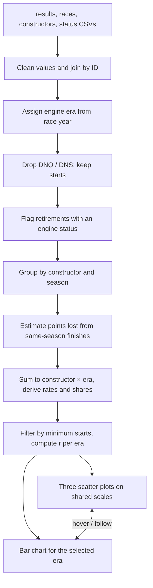

# Constructor reliability visualization

[Back to README](README.md)

The **Constructors** page answers one question:

> **Did engine failures cost constructors their wins, and did that change across the
> V10, V8 and turbo-hybrid engine eras?**

The page has two linked views. The first is an overview: three small-multiple scatter
plots, one per era, that relate a constructor's engine failure rate to its success. The
second is a detail view: a bar chart estimating the race points each constructor lost
to engine failures in the selected era.

**Unit of observation:** one mark is one **constructor in one engine era**, for
example "McLaren, V10 2000–2005". It aggregates all of that constructor's race starts in
the era.

## Design rationale

The page follows the course framework.

| Framework | How this page applies it |
|---|---|
| DIKW | **Data:** result rows with status codes. **Information:** starts, engine failures, wins and points per constructor and era. **Knowledge:** the trend line, the correlation *r* and the estimated points lost show *how* reliability relates to success. **Wisdom:** comparing eras shows when reliability decided championships (V10) and when it stopped being the main differentiator (V8, hybrid). |
| What / Why / How (Munzner) | **What:** a multivariate table of constructor × era with quantitative attributes. **Why:** *discover* and *compare* a **correlation** and spot **outliers**, such as a team that won despite frequent failures. **How:** position on shared scales for the two rates, area for volume, a categorical hue for identity, and linked highlighting. |
| Shneiderman's mantra | **Overview first:** three era panels plus era-wide failure rates. **Zoom & filter:** the minimum-starts threshold, the success measure and the era tabs. **Details on demand:** tooltips, the followed-constructor table and the bar values. |
| Brushing & linking | Hovering or focusing a constructor highlights it in all three scatter plots and in the bar chart at the same time. Following a constructor keeps that highlight on. |
| Overview + Detail | The scatter plots (overview) and the bar chart (detail on cost) are separate, undistorted views. |
| Situation awareness (Endsley) | **Perception:** where the dots sit. **Comprehension:** the slope and *r* within an era. **Projection:** how failure rates moved from one regulation era to the next. |

A scatter plot is the standard form for a correlation between two quantitative
variables. Small multiples on **identical scales** turn the comparison between the three
phases into reading positions across panels, without a dual axis or an animation. The
bar chart answers the separate "how many points" question, which has a different unit
and therefore gets its own view.

## Source data

The page reuses [`loadF1Data.js`](src/lib/loadF1Data.js), which fetches five local CSVs
from [`public/data/`](public/data/):

| File | Key and columns used |
|---|---|
| `results.csv` | `resultId`; `raceId`, `constructorId`, `statusId`, `position`, `positionText`, `points` |
| `races.csv` | `raceId`; `year` (assigns the era and the season) |
| `constructors.csv` | `constructorId`; `name`, `constructorRef` (color) |
| `status.csv` | `statusId`; `status` (engine-failure classification) |
| `drivers.csv` | Loaded by the shared loader to validate joins; not displayed |

Deliberately **not used:**
- `lap_times.csv` (24 MB), which would be needed to estimate the running position at the moment of failure.
- `constructor_standings.csv`, because official standings include adjustments.
- `sprint_results.csv`, because sprints exist only from 2021, which would bias the hybrid era.
- `pit_stops.csv` and `qualifying.csv`.

## Transformation pipeline

All of the logic lives in [`engineReliability.js`](src/lib/engineReliability.js).

1. **Load and clean:** the shared loader converts `\N` and blanks to `null` and parses numbers.
2. **Assign era:** each result's `races.year` is mapped to an era:

   | Era | Seasons | Rules |
   |---|---|---|
   | V10 | 2000–2005 | 3.0 L V10, free development |
   | V8 | 2006–2013 | 2.4 L V8, engine freeze and mileage limits |
   | Turbo-hybrid | 2014–2025 | 1.6 L V6 turbo + energy recovery |

   Results before 2000 and from 2026 (a new power-unit formula, season in progress)
   are **excluded**.
3. **Keep starts:** [`classifyRaceResult`](src/lib/raceResults.js) assigns an outcome to
   each result. Results with outcome `dnq` or `dns` are dropped. Every other result is a
   **start**.
4. **Engine failure:** a start counts as a failure when its outcome is `retired` **and** its
   status is in `ENGINE_STATUSES` (case-insensitive exact match):
   - Engine and power unit: Engine, Engine fire, Engine misfire, Power Unit, Turbo, ERS, Battery, Power loss.
   - Cooling: Overheating, Cooling system, Radiator, and the water pressure, leak, pump and pipe statuses.
   - Oil: the oil pressure, leak, pump, line and pipe statuses.
   - Internals and fuel delivery: Crankshaft, Spark plugs, Ignition, Injection, Fuel pressure, Fuel pump, Fuel system.

   Gearbox, hydraulics, electrical, accidents and the other mechanical statuses are
   **not** engine failures. A classified driver who retired with an engine status, for
   example `P7` with status `Engine`, counts as a failure.
5. **Group by constructor-season:** the pipeline counts starts, failures, wins
   (`position === 1`) and race points (missing points count as 0). It also counts finished
   starts (`Finished` or `+N Laps`) and the points scored in them.
6. **Estimate points lost** for each constructor-season:

   ```text
   pointsLost(season) = failures × (points in finished starts ÷ finished starts)
   ```

   This means each engine failure is credited with the average result the same team
   achieved when its cars finished that season. If the team never finished in that
   season, the estimate is 0.
7. **Aggregate to constructor-era** by summing seasons, then derive:

   ```text
   failureRate = failures ÷ starts
   winRate     = wins ÷ starts
   pointsShare = constructor points ÷ points of all constructors in the era
   lostShare   = pointsLost ÷ (points + pointsLost)
   ```
8. **Summarize eras** with `summarizeEras`:
   - The era-wide failure rate uses every constructor, before filtering.
   - Panels keep only rows with `starts ≥ minStarts`.
   - `r` is the Pearson correlation between `failureRate` and the chosen success measure over the visible rows. It is `n/a` with fewer than 3 rows or a constant variable.



## Layout and encodings

### Scatter plots ([`ReliabilityScatter.jsx`](src/components/ReliabilityScatter.jsx))

| Channel | Encodes |
|---|---|
| Dot (circle) | One constructor in one era |
| Horizontal position | `failureRate`, linear, from 0 to the maximum visible rate across **all three** panels |
| Vertical position | `winRate` or `pointsShare`, chosen by the user; linear, from 0 to the maximum visible value across all panels |
| Dot area | Starts; `r = sqrt scale(starts)`, domain `[0, max visible starts]`, range `[0, 16]` px, minimum radius 4 |
| Dot fill | Constructor identity from [`teamColors.js`](src/lib/teamColors.js), not performance |
| Dashed line | Least-squares regression of y on x for the visible dots, clipped to the plot |
| Labels | Names of the 3 highest dots per panel, plus the highlighted constructor |
| Accent ring / dimming | Hover, focus or follow feedback only; not data |

Both axes use one domain shared by every panel, so positions are directly comparable
between eras. The domains are recalculated when the minimum-starts filter or the success
measure changes. Larger dots are drawn first so that smaller ones stay on top.

### Points-lost bars ([`PointsLostChart.jsx`](src/components/PointsLostChart.jsx))

| Channel | Encodes |
|---|---|
| Row | One constructor in the selected era, sorted by estimated points lost (descending) |
| Solid segment length | Race points scored (team color) |
| Hatched red segment length | Estimated points lost, in the shared retirement color `#d54c59` from [`racePresentation.js`](src/lib/racePresentation.js), with a 45° hatch so it does not depend on color alone |
| End label | `−N pts · X%`, where X is `lostShare`; "no engine DNF" when there were no failures |

The x domain runs from 0 to the maximum of `points + pointsLost` for the selected era,
so bar lengths are comparable within one era only. Raw points are not comparable across
eras because the scoring system changed in 2003 and 2010; use `lostShare` to compare eras.

## Labels and details

- **Era overview tiles:** the failure rate over all starts in the era, and the number of starts.
- **Panel header:** era name and seasons, engine rules, era failure rate, and *r*.
- **Panel footer:** how many constructors are shown and how many fall below the threshold.
- **Tooltip** (hover or keyboard focus): failures/starts, wins and win rate, points and share of the era, and points lost.
- **Followed constructor table:** one row per era with starts, failures, wins, points and estimated points lost, each with its percentage. It shows "Did not race in this era" when there is no row. This table is also an accessible, non-graphical view of the data.

## Interactions

| Control | Effect |
|---|---|
| Success measure | Switches the y variable and recomputes *r* and the y domain (changes the data shown) |
| Minimum starts | Hides part-time constructors; recomputes the scales, *r* and the bars (default 40) |
| Follow a constructor / click / Enter | Persistently highlights a team in every view and shows its era table; click again to clear |
| Hover / focus | Temporary linked highlight across all four charts |
| Era tabs | Choose which era the bar chart details |
| Reset | Restores win rate, 40 starts and no followed constructor |

Every dot and bar is keyboard focusable (`Tab`), activated with `Enter` or `Space`, and
`Escape` hides the tooltip. Highlight transitions are disabled under `prefers-reduced-motion`.

## Interpretation limits

- **Correlation is not causation.** Faster teams may push their engines harder, and customer teams share engines with works teams.
- Status labels are the archive's own. Some historical retirements are recorded only as "Retired" or "Mechanical" and therefore do not count as engine failures, so the counts are lower bounds.
- Points lost is a **counterfactual estimate**. It assumes a failed car would have scored the team's average finished result that season. It ignores the running position at the time of failure, championship standings and the effect on rivals.
- Constructors are grouped by `constructorId`. Renamed teams (such as Toro Rosso → AlphaTauri → RB, or Force India → Racing Point → Aston Martin) appear as separate dots.
- Race points only, as recorded in `results.csv` (fastest-lap bonus points from 2019–2024 are included there). Sprint points and penalties applied to the championship are not modelled.
- The hybrid era (12 seasons) contains more starts than the V10 era (6 seasons). The rates are normalized, but the totals are not.

## Implementation and validation

- Data logic: [`src/lib/engineReliability.js`](src/lib/engineReliability.js). Formatting and colors: [`src/lib/reliabilityPresentation.js`](src/lib/reliabilityPresentation.js).
- Page: [`src/ConstructorDashboard.jsx`](src/ConstructorDashboard.jsx), [`src/ConstructorDashboard.css`](src/ConstructorDashboard.css).
- Tests: [`tests/engineReliability.test.js`](tests/engineReliability.test.js) cover:
  - engine-status matching and era boundaries (2026 and pre-2000 excluded);
  - Pearson edge cases;
  - start, failure, win and point counting, including classified engine retirements, DNQ exclusion and the zero-finish estimate;
  - threshold filtering with era totals;
  - real-data invariants: points shares sum to 1 per era, failures and wins never exceed starts, and row IDs are unique.

Run the [README validation commands](README.md#validation).
