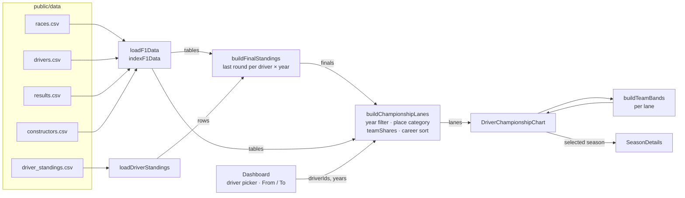

# Driver championship timeline

[← README](README.md)

Compare up to 20 drivers by their final Drivers' Championship place each season.

- **Lane:** one driver.
- **Dot:** one driver-season.

## Data flow

## Sources

| File | Columns | Use |
| --- | --- | --- |
| `driver_standings.csv` | `raceId`, `driverId`, `position`, `positionText`, `points`, `wins` | Place, points, wins |
| `races.csv` | `raceId`, `year`, `round` | Season and round of each standing |
| `drivers.csv` | `driverId`, names | Lane labels |
| `results.csv` + `constructors.csv` | `driverId`, `raceId`, `constructorId`, `constructorRef`, `name` | Teams per season |

Not used: `constructor_standings.csv`, `seasons.csv`, `sprint_results.csv`.

## Pipeline

Code: [`src/lib/championshipStandings.js`](src/lib/championshipStandings.js).

1. **`buildFinalStandings`**: for each driver × year, keep the standings row with the highest `round`.
   - `positionText` `D` (excluded, Schumacher 1997) or `-` (unranked) → `position = null`.
   - `\N` → `null`.
   - `round` < the year's last scheduled round → `provisional`.
2. **`buildChampionshipLanes`**:
   - Filters seasons to the inclusive `[fromYear, toYear]`.
   - Adds a place category to each season.
   - Adds `teamShares`: constructors ordered by first round, with distinct race counts.
   - Sorts lanes by career. The sort ignores the year filter.
3. **`buildTeamBands`**: splits each season slot `[year − 0.5, year + 0.5]` between teams by race count, and merges touching pieces of the same team.

## Layout and scales

- **Chart:** lane (strip) chart, 60px per driver.
- **Lane order:** latest championship season first, then latest first season, then name. Drivers without standings go last.
- **x:** `scaleLinear` over years, domain `[first − 0.5, last + 0.5]` across the selection, so each season gets an equal slot.
- **y:** one band per driver. Height within a lane carries no data.
- **Dot radius:** `clamp(slot / 2 − 1.5, 4, 11)` px. Numbers are hidden below 7.5px.

## Encodings

| Datum | Encoding |
| --- | --- |
| Final place | Dot fill + number inside |
| Consecutive seasons | Solid line |
| Missed seasons | Dashed, faint line |
| Season in progress | Dashed ring |
| Team | Pale band in team color, named when it fits; split by races on a mid-season switch |
| Hover / keyboard / selected | Dark ring / dark ring / accent ring |
| Lane summary | `N titles · best Xth` |

## Palette

| Place | Light | Dark |
| --- | --- | --- |
| 1st | `#c9a227` gold | `#e0b83a` |
| 2nd | `#a3a9b0` silver | `#b8bec6` |
| 3rd | `#b06f35` bronze | `#c8844a` |
| 4th+ | `#2e9d5b` green | `#3fb874` |
| Excluded / unranked | `#9a97a3` | `#6e6b78` |

- **Dot numbers:** always `#14121a`, so color is never the only cue.
- **Team bands:** colors from `getTeamColor(constructorRef)` ([`teamColors.js`](src/lib/teamColors.js)): curated for known teams, otherwise a stable hash into `schemeTableau10`. These are identifiers, not liveries.
- **Band opacity:** 0.16 light / 0.22 dark, with a 1px gap between different teams.

## Labels and interactions

- **Tooltip:** place ("so far" if provisional), driver and year, points, wins, teams (race counts when split), and the round of a provisional standing.
- **Season details panel:** the same fields for the clicked season.
- **Narrow screens:** lanes show surnames.
- **Filters:** the driver picker and From / To seasons change the data.
- **Mouse:** hover shows the tooltip; click selects a season.
- **Keyboard:**
  - ← / →: move through the seasons.
  - Home / End: first or last season.
  - ↑ / ↓: nearest season of the adjacent driver.
  - Enter: select.
  - Esc: clear.
- **Table:** "Show table" lists every driver-season.

## Limits

- Places and points are the official standings, including sprint points and penalties.
- Points systems changed, so compare places across eras rather than points.
- A season with no standings row has no dot.
- The latest season may be incomplete. The provisional ring marks it.

## Implementation

- **Components:**
  - [`DriverChampionshipChart.jsx`](src/components/DriverChampionshipChart.jsx)
  - [`SeasonDetails.jsx`](src/components/SeasonDetails.jsx)
  - [`Dashboard.jsx`](src/Dashboard.jsx)
