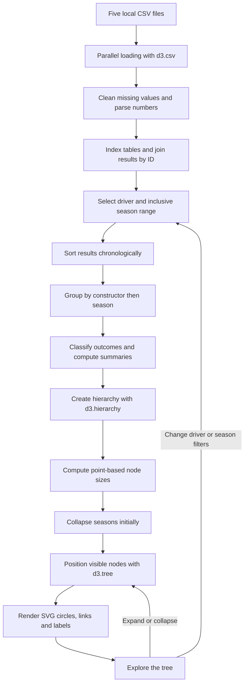

# Driver visualization

[Back to README](README.md)

A horizontal tidy tree answers: **which constructors did a driver race for, in which
seasons, and with what results?** Its hierarchy is:

**Driver → Constructor → Season → Race result**

Each leaf represents one driver's result row, not an entire race. Constructor branches
contain only the selected driver's results.

## Data pipeline

Five local CSVs from [`public/data/`](public/data/) supply the data:

| File | Key and purpose |
|---|---|
| `results.csv` | `resultId`; links driver, constructor, race and status; supplies grid, position and points |
| `drivers.csv` | `driverId`; name, search code and nationality |
| `constructors.csv` | `constructorId`; name and color reference |
| `races.csv` | `raceId`; season, round, name and date |
| `status.csv` | `statusId`; finishing status, such as Finished or Engine |

1. **Load and clean:** [`loadF1Data.js`](src/lib/loadF1Data.js) fetches/caches the CSVs with
   `d3.csv`, parses numbers and converts `\N`, blanks and invalid numbers to `null`.
2. **Join:** numeric-ID maps connect results to the other tables. Results without a
   driver or race are excluded; missing constructor/status information uses fallbacks.
3. **Filter:** select one driver and an inclusive From/To season range. Search narrows
   dropdown options; selecting an option changes the tree. Reset restores the full career.
4. **Group:** [`buildDriverTree.js`](src/lib/buildDriverTree.js) sorts by year/round, groups
   by constructor then season, and orders constructors by their first filtered race.
   Mid-season switches create separate constructor branches; later returns reuse a branch.
5. **Summarize:** entries count result rows; wins/podiums count classified P1/P1–P3;
   points are summed with missing values contributing zero; seasons/constructors count distinct IDs/years.
6. **Render:** [`DriverTree.jsx`](src/components/DriverTree.jsx) uses `d3.hierarchy`,
   `d3.tree` and `d3.linkHorizontal` to draw SVG nodes and links. Seasons start collapsed.



## Shapes, position and size

| Mark | Meaning | Size and appearance |
|---|---|---|
| Driver circle | Selected driver | Radius 8; theme foreground color |
| Constructor circle | Driver's results with that team | Radius 10–24, scaled by branch points; team color |
| Season circle | Driver's season with that team | Same points scale and team color |
| Race circle | Individual result | Radius 7 for classified P1–P3, otherwise 5; result color below |
| Curved link | Parent-child membership | Uniform width 1.5; theme border color |
| `+` inside a circle | Collapsed children | Interaction indicator, not data |
| Accent outline | Hover, focus or selected race | Radius = node radius + 4; not a performance encoding |

Horizontal position indicates hierarchy depth; vertical order follows the grouped tree.
**Distances are not elapsed time.** All entity marks are circles; labels identify their type.

[`treeNodeRadius.js`](src/lib/treeNodeRadius.js) uses a shared square-root radius scale:

```text
radius = 10 + 14 × sqrt(clamp(points / M, 0, 1))
M = maximum constructor/season points in the filtered tree, or 1 if all are zero
```

Sizes are SVG units and grow with zoom. Zero-point branches remain visible. Collapsing
does not change the scale, but changing filters can. Areas are not exactly proportional
to points because of the minimum radius.

## Colors

Constructor/season colors identify teams, not performance. Examples: Ferrari red
`#e80020`, McLaren orange `#ff8000`, Mercedes turquoise `#27f4d2`. The full palette is in
[`teamColors.js`](src/lib/teamColors.js); other references hash into D3's `schemeTableau10`,
and missing references use `#8b949e`. Colors may repeat, so names remain essential.

Race colors follow these rules **in priority order**:

| Condition | Color |
|---|---|
| Retired, even with a classified position | Red `#d54c59` |
| Other non-finished/unknown outcome: DSQ, DNS, DNQ, EXC, NC | Purple `#9a64bc` |
| Finished P1 | Gold `#bb8b20` |
| Finished P2 | Silver-gray `#8b96a5` |
| Finished P3 | Bronze `#b77748` |
| Other finished result with positive points | Teal `#23877d` |
| Other finished result with zero/missing points | Gray `#95929e` |

[`raceResults.js`](src/lib/raceResults.js) separates official position from outcome:
`P7` with an Engine retirement stays labeled `P7` but is red. `Finished` and `+N Lap(s)`
are finished outcomes. Missing position alone does not imply retirement; `positionOrder`
is never substituted for classified position. Colors come from
[`racePresentation.js`](src/lib/racePresentation.js), not the constructor palette.

## Labels and interactions

- **Overview:** driver name/nationality, entries, seasons, constructors, wins, podiums and points.
- **Branch captions:** entries and points. **Race labels:** name/result; captions add round, grid and points.
- **Hover/focus:** full race information. **Select a race:** persistent driver/team, date,
  season/round, grid, classified position, points and official status. Missing values are
  explicit; a zero/missing grid displays “Not recorded / pit lane,” not a confirmed pit-lane start.
- Click or use **Tab + Enter/Space** to expand/select. Expand all, Collapse all, pan, zoom
  and Fit tree change presentation—not totals. Driver/year changes rebuild the filtered
  tree and clear race selection; invalid/empty ranges show a message.

## Limits and validation

- Entries include DNS/DNQ and historical shared-drive records; entries are not starts.
- Points are this driver's Grand Prix totals, not team/championship standings. Sprint
  points, championship adjustments and historical scoring normalization are not included.
- Footer coverage is archive-wide and based on joined results, not scheduled races.
- Labels/details supplement color; theme foreground, border and accent colors are UI styling.

[`tests/`](tests/) cover normalization, grouping, filtering, result classification, colors
and sizes. Run the [README validation commands](README.md#validation).
