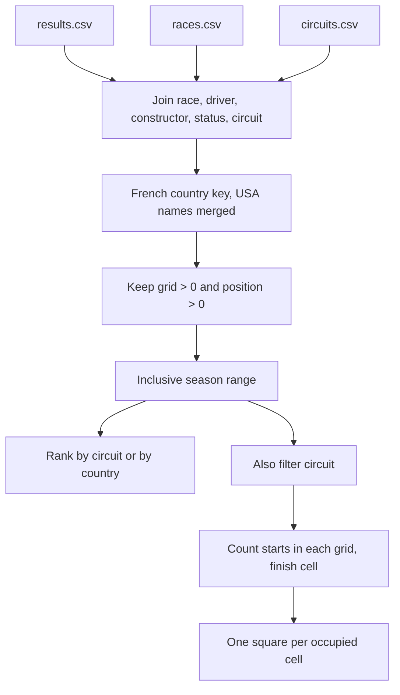

# Race visualization

[Back to README](README.md)

Two views answer: **where does a starting place stop predicting the classified finish, by circuit and by country?**

The ranking compares circuits, or countries. The grid of squares shows one filtered slice in detail. One square is every classified start that shared the same grid place and the same finishing place. It is not one race, and it is not a driver.

The page opens from the **Races** capsule. The page text, legends, axis captions and status labels are in French. Circuit, driver and constructor names stay as recorded. The shared section navigation stays in English, because it is also used by the driver page.

## Data pipeline

Six local CSVs from [`public/data/`](public/data/) supply the data. Sprint results, qualifying
sessions, lap times, pit stops and standings are not used.

| File | Key and purpose |
|---|---|
| `results.csv` | `resultId`; `grid`, `position`, `points`, `statusId`, plus driver, constructor and race ids |
| `races.csv` | `raceId`; season, round, name and `circuitId` |
| `circuits.csv` | `circuitId`; circuit name and country, used as labels |
| `drivers.csv` | `driverId`; the name shown when a square is opened |
| `constructors.csv` | `constructorId`; name and the existing team color |
| `status.csv` | `statusId`; the official finishing status, translated only for display |

1. **Load and clean.** [`loadF1Data.js`](src/lib/loadF1Data.js) loads the five race tables.
   [`loadCircuitBoard.js`](src/lib/loadCircuitBoard.js) adds `circuits.csv`. `\N`, blanks and
   invalid numbers become `null`, never zero.
2. **Join.** [`gridFinish.js`](src/lib/gridFinish.js) keeps a result only when its race exists.
   A missing circuit record does not drop the start: the label falls back to `Circuit {id}`
   and the country becomes `Pays non enregistré`.
3. **Name the country.** [`countryLabels.js`](src/lib/countryLabels.js) maps the archive country
   to a stable key and a French label. `USA` and `United States` share the key `united-states`
   and the label `États-Unis`. An unknown country keeps its archive text and a key prefixed
   with `other:`. The CSV is not rewritten.
4. **Keep classified starts with a grid.** `grid` must be greater than 0. A missing position
   is excluded even if `positionOrder` has a number. A row missing both is counted once, as
   "no recorded grid". [`classifyRaceResult`](src/lib/raceResults.js) still reads the English
   status. [`statusLabels.js`](src/lib/statusLabels.js) translates it afterwards, for the table only.
   A status that is not in that list stays in English. `+N Lap(s)` becomes `+N tour` or `+N tours`.
5. **Derive** `placesGained = grid - position`. Positive means the driver was classified ahead
   of the grid place. The median of an even count is the mean of the two central values.
6. **Filter.** Circuit, first season and last season are inclusive and combine.
   There is no country filter. A reversed season range matches nothing. Filtering does not
   change the excluded-row rules. The excluded-row counts use the same filters.
7. **Rank, or focus one circuit.** With no circuit chosen, the ranking uses the season range
   only. Groups are one circuit or one country. Sort is the signed median of places gained,
   largest gain first, then the number of classified starts, then the French label. A loss of
   6 places sits below a gain of 6. Each row also prints the number of distinct races.
   Choosing a circuit replaces that list with that circuit alone. The summary is still the
   signed median and the race count. Under it, one row per exact gap counts the classified
   starts with that gap, largest gain first. Those rows are not buttons and do not list
   drivers. Missing gaps are omitted. The season range still
   applies, so “every race” means every race of this circuit inside the chosen seasons.
   Clearing the circuit restores the comparison. Par pays is available only in that comparison.
8. **Bin the filtered slice.** The remaining starts are grouped by the exact pair `(grid, position)`.
   The axis maximum is the largest grid or finish still present, so a filter rebuilds the axes.

## Layout

[`GainRankChart.jsx`](src/components/GainRankChart.jsx) draws one horizontal bar per circuit or per country.
The top row is the largest signed median. When one circuit is chosen, that chart keeps a single
bar for the circuit, and [`GapDetailChart.jsx`](src/components/GapDetailChart.jsx) draws one
bar per exact places-gained value. Those detail bars encode a count, so they all grow to the
right. Row spacing is constant: it does not encode the difference between two medians or two gaps.
The text at the end of a ranking row is the median, then the number of distinct races, for example
`+6 · 10 courses`. The text at the end of a detail row is the number of classified starts.

[`GridFinishChart.jsx`](src/components/GridFinishChart.jsx) draws one SVG. The drawing scales to the full width of its panel, and the panel does not clip it in a nested scroll: the page scrolls instead. Columns are grid
places from 1 on the left, and each place number is drawn above its column. Rows are classified finishes from P1 at the top. A dashed line
runs through the cells where grid equals finish. Distance from that line is the number of
places gained or lost, in classified places. It is not a lap gap, and it is not comparable
across decades without the season filter: a gain of five places in a 33-car field is not the
same event as a gain of five in a 20-car field.

## Visual encodings

| Data | Mark and channel |
|---|---|
| Circuit or country, with none chosen | One ranking row. Order is the signed median, largest gain first |
| Chosen circuit | Replaces the ranking with one summary bar, then one row per exact gap |
| Signed median of places gained | Bar length from zero, and the first number at the end of the row. Positive is to the right |
| Distinct races in the row | Text after the median, for example `10 courses`. Two classified starters in one race count once |
| Exact places gained, in the circuit detail | One row, labeled with the signed gap. Order is the gap, largest gain first. A missing row means zero classified starts, not missing data. The row is not a button |
| Opened square | A floating panel over the page, up to two at once. One row per classified start in that grid and finish: date, French country, circuit, driver, constructor. The title bar moves the panel |
| Classified starts with that exact gap | Bar length from the left, and the count at the end of the row. The longest bar is the fullest gap in this circuit and season range |
| Zero | Dashed vertical line on the summary bar: classified on the grid place. A detail row labeled 0 is that same case, and the detail chart has no zero line |
| Bar fill | Constant `var(--text-h)`. It does not encode the sign or the group |
| Selected ranking row | Accent stroke and accent row wash. This is interaction state |
| Grid place | Column, left to right, one column per integer from 1 to the filtered maximum. The place number sits above the column |
| Classified finish | Row, top to bottom, P1 at the top |
| Number of starts in that pair | Fill color, from blue `#1d4ed8` at a single start to orange `#ff7a00` at the fullest cell, through magenta `#d946ef`. The count is also written in the square |
| Grid equals finish | Dashed line through those cell centers. The line encodes equality, not a count |
| Selected square | Accent stroke while its panel is open. Two squares can be selected. This is interaction state, not a data category |
| Empty pair | No square. Absence means zero starts, not missing data |
| Constructor, in the opened list | Existing color from [`teamColors.js`](src/lib/teamColors.js), plus the constructor name |

The detail bars use the fullest gap in the current circuit and season range as 100 percent of
the plot width. A season or circuit change rebuilds that peak. Compare gaps with the printed
count.

The ranking domain is symmetric around zero and uses the largest absolute median in the
current season range, or 1 when every median is 0. A season change rebuilds it, so two
season ranges must be compared with the printed median, not with the bar length.

The color domain is recalculated after every circuit and season filter. The ramp is
`t = sqrt(count / peak)` in [`gridHeat.js`](src/lib/gridHeat.js), so the middle of the scale
is not stuck on the low color. An orange square in one season range can represent fewer
starts than a bluer square in another range. The digit inside the square is the comparable
value. Text is white on the darker blue squares and `#141018` on the brighter orange squares. This scale
counts starts. It does not use the race-result colors.

Signed numbers use [`formatSigned.js`](src/lib/formatSigned.js): one decimal, a comma, and a
plus sign when the value is positive. `+1,5` and `-0,5` are the display forms.

## Labels and interactions

French captions on the page:

| Control or mark | Label |
|---|---|
| Circuit filter | Chercher un circuit, then Circuit. Options are ordered by distinct race count, busiest first, with `Tous les circuits` above them. There is no country filter |
| Seasons | Saison de début, Saison de fin, Réinitialiser |
| Ranking switch | Par circuit, Par pays |
| Ranking direction | À gauche : fini derrière la grille. 0 : même place qu’au départ. À droite : fini devant la grille |
| Ranking legend | `+6 · 10 courses` is a median gain of six classified places across 10 races. Grid place minus finish: starting 10th and finishing 4th counts as +6. Starting first and winning counts as 0. Bar color does not change. Zero means classified on the grid place. Sort is that signed gap, largest first. Row spacing is not the gap between medians |
| Axis captions | Axe horizontal : position de départ sur la grille. Axe vertical : position d’arrivée classée, P1 en haut |
| Square legend | Faible effectif de départs classés. Effectif le plus élevé dans le filtre courant. Arrivée classée à la position de grille. Selecting a square opens its list. A second square opens another. The title bar moves a list. Fermer, Escape, or selecting the same square again closes the front list. A third selection replaces the older list |
| Summary | Départs classés, Médiane des places gagnées, Arrivées à la place de la grille, Grille non enregistrée, Non classés |
| Handy counts | Courses in the current filter, and that count as a percentage of the busiest circuit in the same season range. Classified starts from grid 1, as a percentage of classified starts. Grid 1 finished in P1, as a percentage of grid-1 starts. All P1 finishes, and the share of those wins that started from grid 1. A percentage with no denominator is — |

- The ranking panel is kept in [`src/Races.jsx`](src/Races.jsx) and is not rendered while `showPlaceRank` is false. Set that constant to true to put "Qui la grille prédit le moins" back on the page. The behavior below is unchanged when it is shown.
- With no circuit chosen, the ranking follows the chosen seasons only. Its order is the signed
  median places gained, largest gain first, so a short-lived circuit can sit above Monza. The
  race count printed beside the median does not set that order. Choosing a circuit, from the
  menu or from a ranking row, replaces the list with that circuit: its median, its race count,
  how many classified starts gained places, held the grid place, or lost places, and one row
  for every exact gap. The gap rows only count starts. A second click on the summary bar, or Revoir tous les circuits, restores
  the comparison. Par pays only regroups that comparison.
- Filters on the squares: one circuit or all circuits, an inclusive first season, an inclusive
  last season, and Réinitialiser.
  The circuit menu counts distinct races that still have a classified start, not driver rows:
  two starters in the same race count as one course. The busiest circuit is the first option.
  The search box matches the circuit name or the country, without accents, and only narrows
  that menu. It does not change the squares until a circuit is chosen. Réinitialiser clears
  the search as well. Changing Par circuit / Par pays changes the ranking presentation, not the square totals.
- The summary counts classified starts, the median places gained, starts that finished on
  their grid place, starts with no recorded grid, and unclassified starts. The last two follow
  the same circuit and season filters.
- The handy counts use that same slice. Courses are distinct races. The maximum is the busiest
  circuit in the season range, even when one circuit is selected. Grid 1 is the pole. P1 is a
  classified win. A grid-1 win is both. Percentages are half-up to one decimal.
- Hover or keyboard focus shows the grid, the finish and the count. A square or a ranking row
  is a button: click it, or press Enter or Space. Choosing a square opens a floating panel.
  Choosing another square opens a second panel, and the matrix stays clickable. Dragging the
  title bar moves that panel. Choosing the same square again closes its panel. Fermer closes
  that panel. Escape closes the panel in front. A third square replaces the older of the two.
- Each panel lists the date, the French country, the circuit, the driver and the constructor
  for every classified start in that grid and finish, in season and round order. It is not
  truncated. `P1` stays `P1`. A missing date is —. The gap chart does not open this list.
  The panel is wide enough to show the constructor without a horizontal scrollbar.
- A driver name in that list opens the driver championship timeline with that driver alone.
  The season of the selected start is outlined in red on that timeline. A season with no
  championship standing has no dot to outline.
- The Pilote column header opens every driver of that square at once, one lane per driver.
  Every season with a start in that square is outlined in red, so a driver who appears twice
  in the square gets two outlined seasons. The number of lanes is not capped, so a busy
  square such as grid 1 to P1 gives a long timeline.
- A constructor name opens the constructor speed × reliability page filtered on that
  constructor: only its seasons stay in the scatter plot and the heatmap, and the season of
  the selected start is outlined in red in both views.   The Écurie column header puts
  every constructor of the square in that filter at once, each in its own color for comparison,
  and outlines in red the season of each of their starts in that square.
  That page only covers 2000–2025. A red note there names what it cannot show: an earlier
  season of a covered constructor is not outlined, and a constructor that did not compete
  between 2000 and 2025 stays in the filter but has no engine-failure data to show.

## Limits

- Races without a result row are not included. A season in the year list is a season that has results.
- Pit-lane and unrecorded grids are outside the squares. So are retirements and other results
  with no classified position. A circuit with many retirements can look more predictable than it is.
- Qualifying times are not compared. The grid already includes penalties, so it is the start
  that the race actually used.
- Points and sprint results are not part of the count. The median is a median of places, not of points.
- A median near zero can still hide a wide spread. The squares show that spread, and so does
  the exact-gap list of a chosen circuit. The comparison ranking does not.
- Par pays adds every circuit of a country into one median. France, Spain, Italy, the United
  Kingdom, Germany, Japan and the United States mix different tracks. Monaco does not.
  That grouping does not filter the squares.
- Team color identifies the constructor in the list. It does not encode a gain or a loss.
- The ranking bar color does not encode a category. Position relative to zero and the signed number do.

## Implementation and validation

- Transformation: [`src/lib/gridFinish.js`](src/lib/gridFinish.js)
- Country and status labels: [`src/lib/countryLabels.js`](src/lib/countryLabels.js), [`src/lib/statusLabels.js`](src/lib/statusLabels.js)
- Loading: [`src/lib/loadCircuitBoard.js`](src/lib/loadCircuitBoard.js)
- Page and charts: [`src/Races.jsx`](src/Races.jsx), [`src/components/GainRankChart.jsx`](src/components/GainRankChart.jsx), [`src/components/GapDetailChart.jsx`](src/components/GapDetailChart.jsx), [`src/components/GridFinishChart.jsx`](src/components/GridFinishChart.jsx), [`src/components/GridDetailPanel.jsx`](src/components/GridDetailPanel.jsx)
- Tests: [`tests/gridHeat.test.js`](tests/gridHeat.test.js) covers the blue-to-orange ramp and the text contrast. [`tests/gridFinish.test.js`](tests/gridFinish.test.js) covers exclusion of a pit-lane
  retirement, the unused `positionOrder`, a missing circuit label, inclusive filters,
  the rebuilt axis maximum, the median, the merged United States names, ranking order, and the
  exact-gap detail of one circuit, and the pole, win and race-count shares.
  [`tests/frenchLabels.test.js`](tests/frenchLabels.test.js) checks that every country in
  `circuits.csv` and every status in `status.csv` has a French display label.
